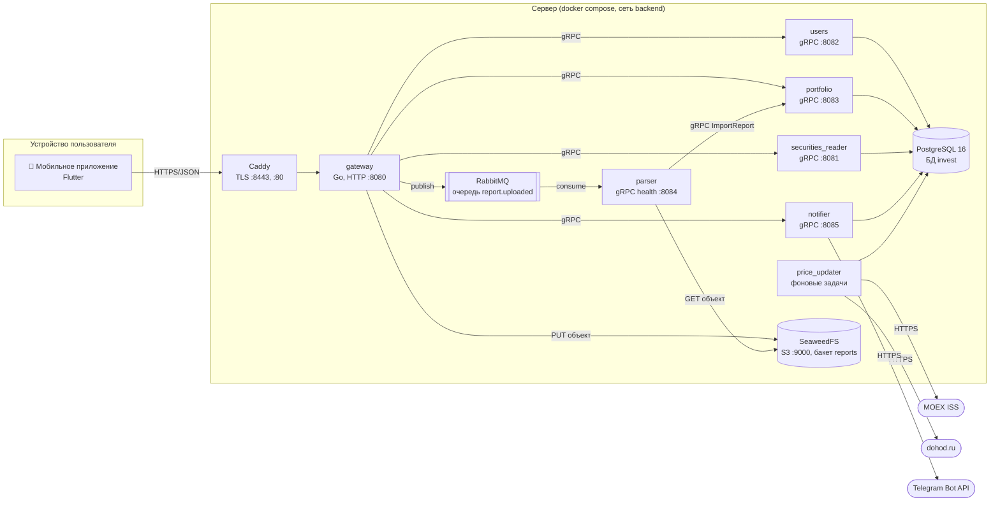

# 2. Архитектура

## 2.1. Цели качества

| № | Атрибут качества | Как обеспечивается |
|---|---|---|
| 1 | **Корректность расчётов** | неизменяемый журнал операций вместо хранения итогов; P&L — чистая функция с юнит-тестами (`portfolio/internal/pnl`); тесты парсера на реальных обезличенных отчётах со сверкой итогов «до копейки» |
| 2 | **Идемпотентность и целостность данных** | импорт отчёта — одна транзакция; дедупликация по `external_id`; транзакционные миграции с учётом применённых файлов |
| 3 | **Безопасность учётных данных** | bcrypt для паролей; refresh-токены хранятся только как SHA-256 хеш, ротация и обнаружение повторного использования; единственная точка входа |
| 4 | **Отзывчивость клиента** | импорт отчёта асинхронный; графики читаются из БД; карточки и дивиденды также читаются из БД |
| 5 | **Сопровождаемость** | сервисы с узкой ответственностью; контракты в `.proto`; README у каждого сервиса; CI с `gofmt`, `go vet`, `go test -race` |
| 6 | **Простота эксплуатации** | весь стек — один `docker-compose.yml`; выкатка по git-тегу; откат на уже собранный тег |

Целевые RPS, задержки, доступность и RPO/RTO не заданы.

## 2.2. Ограничения

| Тип | Ограничение | Следствие |
|---|---|---|
| Технические | данные о ценах берутся только из бесплатного публичного MOEX ISS API без потоковой подписки | цены обновляются опросом раз в минуту |
| Технические | MOEX ISS не отдаёт дивиденды | дивиденды разбираются из HTML-страниц dohod.ru (хрупкая интеграция) |
| Технические | интеграция с API брокеров не реализована | данные о сделках приходят только из загружаемых отчётов |

## 2.3. Контекст системы

Внешние интерфейсы:

| Партнёр | Направление | Протокол | Частота | Что при недоступности |
|---|---|---|---|---|
| Мобильное приложение → gateway | вход | HTTPS + JSON, `Authorization: Bearer` | по действиям пользователя | — |
| MOEX ISS (`price_updater`) | выход | HTTPS + JSON | цены раз в минуту; отдельная задача загружает 10-минутные свечи; ночью — дневная история; описание и эмитент — раз в 12 ч | ошибка логируется, следующий тик пробует снова; цены «замирают» |
| dohod.ru (`price_updater`) | выход | HTTPS + HTML | фоновое обновление раз в 24 ч для каждой бумаги | сохраняются последние успешно загруженные дивиденды |
| Telegram (`notifier`) | выход | HTTPS, long polling | раз в минуту проверка и непрерывный `getUpdates` | уведомление повторится на следующей проверке |

## 2.4. Стратегия решения

| Задача | Решение | ADR |
|---|---|---|
| Разделить предметные области | микросервисы по ограниченным контекстам: пользователи, портфель, рыночные данные (запись / чтение), импорт отчётов, уведомления | [0001](adr/0001-microservices-shared-database.md) |
| Один вход снаружи | `gateway` — единственный публичный сервис, проверяет JWT и передаёт дальше `x-user-id` | [0002](adr/0002-single-gateway-trust-model.md) |
| Межсервисное взаимодействие | синхронно — gRPC; асинхронно — RabbitMQ | [0003](adr/0003-grpc-internal-communication.md), [0005](adr/0005-async-report-import.md) |
| Контракты | `.proto` хранится только у сервиса-владельца, клиенты генерируют код при сборке | [0004](adr/0004-proto-ownership.md) |
| Учёт портфеля | неизменяемый журнал операций, расчёт по средневзвешенной цене | [0006](adr/0006-trade-journal-weighted-average.md) |
| Повторные загрузки отчётов | идемпотентный импорт по `external_id` | [0007](adr/0007-idempotent-import-external-id.md) |
| Объектное хранилище | SeaweedFS с S3 API для отчётов, подключение через `S3_*` | [0009](adr/0009-seaweedfs-instead-of-minio.md) |
| Сессии | короткий JWT и ротируемый refresh-токен с семьями | [0008](adr/0008-refresh-token-rotation.md) |
| Рыночные данные | разделение на писателя (`price_updater`) и читателя (`securities_reader`); в PostgreSQL хранятся последние цены, свечи, описания бумаг и дивиденды | [0014](adr/0014-candles-from-database.md), [0015](adr/0015-reader-database-only.md) |
| Развёртывание | один сервер, Docker Compose, выкатка по тегу, Caddy | [0010](adr/0010-deploy-compose-single-server.md) |
| Health-checks | собственный синхронный gRPC health-сервер, проверка зависимостей на каждый вызов | — |
| Библиотеки | `lib/pq`, `golang-jwt`, `minio-go` v7.0.95, `amqp091-go` | — |

## 2.5. Контейнеры (C4, уровень 2)

| Контейнер | Технология | Ответственность | Публичный порт |
|---|---|---|---|
| Мобильное приложение | Flutter | UI, хранение сессии, опрос статуса импорта | — |
| Caddy | Caddy 2 | TLS-терминация, gzip, обратный прокси на gateway (только в production, профиль `https`) | 80, 8443 |
| `gateway` | Go, `net/http` | REST API, проверка JWT, перевод HTTP ↔ gRPC, приём файлов отчётов | 8080 (в production только на `127.0.0.1`) |
| `users` | Go, gRPC | аккаунты, пароли, выпуск и ротация токенов | нет |
| `portfolio` | Go, gRPC | портфели, журнал сделок и денежных операций, P&L, история стоимости, брокеры, статусы импорта | нет |
| `securities_reader` | Go, gRPC | чтение цен, свечей, поиск, карточка бумаги, дивиденды | нет |
| `price_updater` | Go, фоновые задачи | загрузка цен, свечей, описаний бумаг и дивидендов | нет |
| `parser` | Go, AMQP-воркер | разбор отчётов брокера, передача операций в `portfolio` | нет |
| `notifier` | Go, gRPC + Telegram-бот | ценовые алерты, привязка Telegram, проверка раз в минуту | нет |
| PostgreSQL | PostgreSQL 16 | общая БД `invest`, у каждого сервиса свои таблицы | `127.0.0.1:5432` |
| SeaweedFS | `chrislusf/seaweedfs:4.06` | исходные файлы отчётов | `127.0.0.1:9000` |
| RabbitMQ | `rabbitmq:3-management` | очередь задач разбора | `127.0.0.1:5672`, UI `127.0.0.1:15672` |

## 2.6. Ключевые компоненты по сервисам:

| Сервис | Компоненты |
|---|---|
| `gateway` | `httpapi` (маршруты, middleware `requireAuth`, трансляция gRPC-кодов в HTTP), `auth` (проверка JWT HS256), `upstream` (gRPC-клиенты и сводный health-check), `objectstore` (S3), `queue` (RabbitMQ publisher), `task` (формат задачи), `static/brokers` (встроенные иконки брокеров), `*pb` (сгенерированные клиенты) |
| `users` | `auth` (bcrypt, выпуск JWT, генерация и хеширование refresh-токенов), `grpcserver`, `storage`, `cleanup` (фоновая чистка истёкших refresh-токенов) |
| `portfolio` | `grpcserver` (RPC, проверка владения, составные портфели, смена площадки бумаги), `pnl` (чистые функции расчёта P&L и истории стоимости), `storage` |
| `price_updater` | `moexclient` (цены и свечи ISS), `moex` (описание и эмитент), `dohod` (дивиденды), `updater` (фоновые задачи), `storage` (upsert через `COPY`, метаданные JSONB) |
| `securities_reader` | `grpcserver` (цены, свечи, поиск, описание, дивиденды), `storage`; внешних клиентов и TTL-кэшей нет |
| `parser` | `queue` (consumer с `prefetch=1`), `worker` (жизненный цикл задачи и классификация ошибок), `parsing` (интерфейс `Parser` и диспетчер по брокеру), `parsing/sber` (парсер отчёта СберИнвестиций), `objectstore`, `portfolioclient` |
| `notifier` | `grpcserver`, `checker` (проверка алертов раз в минуту), `bot` (обработка `/start`, `/stop`), `telegram` (клиент Bot API), `linktoken` (одноразовые токены привязки), `storage` |

## 2.7. Сквозные концепции

### Идентификация пользователя между сервисами

`gateway` проверяет подпись JWT и передаёт идентификатор пользователя во
внутренние вызовы через gRPC metadata `x-user-id`. Внутренние сервисы верят
этому значению без криптографической проверки, потому что недоступны извне
docker-сети. Подробнее — в [Безопасности](05-security.md) и
[ADR-0002](adr/0002-single-gateway-trust-model.md).

### Обработка ошибок

- Внутренние сервисы возвращают стандартные gRPC-коды.
- `gateway` транслирует их в HTTP-статусы (`writeUpstreamError`), тело
  ошибки всегда `{"error": "<сообщение>"}`:

| gRPC-код | HTTP |
|---|---|
| `InvalidArgument` | 400 |
| `Unauthenticated` | 401 |
| `PermissionDenied` | 403 |
| `NotFound` | 404 |
| `AlreadyExists` | 409 |
| `FailedPrecondition` | 422 |
| `Unavailable`, не-gRPC ошибка | 502 |
| прочие | 500 |

### Логирование

Все сервисы пишут структурированные JSON-логи в stdout через `log/slog`;
уровень задаёт `LOG_LEVEL`. Сбор и хранение логов — средствами Docker
(`docker compose logs`). Централизованного сбора логов нет

### Graceful shutdown

Все сервисы подписываются на `SIGINT`/`SIGTERM` (`signal.NotifyContext`)
и корректно останавливают серверы и фоновые циклы.

### Конфигурация

Только переменные окружения (12-factor). Секреты — в `backend/.env`,
в `docker-compose.yml` их нет. Переменные для запуска перечислены в
[шаблоне .env](../backend/.env.example) и в [Docker Compose](../backend/docker-compose.yml).

### Генерация кода

`*.pb.go` в git не хранятся: каждый Dockerfile и CI генерируют их из
`.proto` (`make clean proto`). Версии плагинов закреплены:
`protoc-gen-go v1.36.5`, `protoc-gen-go-grpc v1.5.1`.
