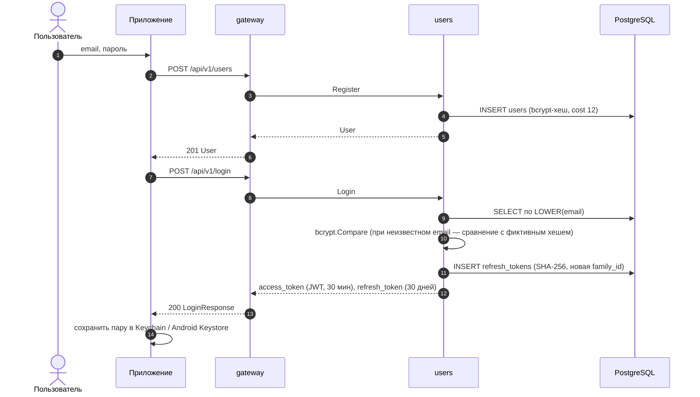
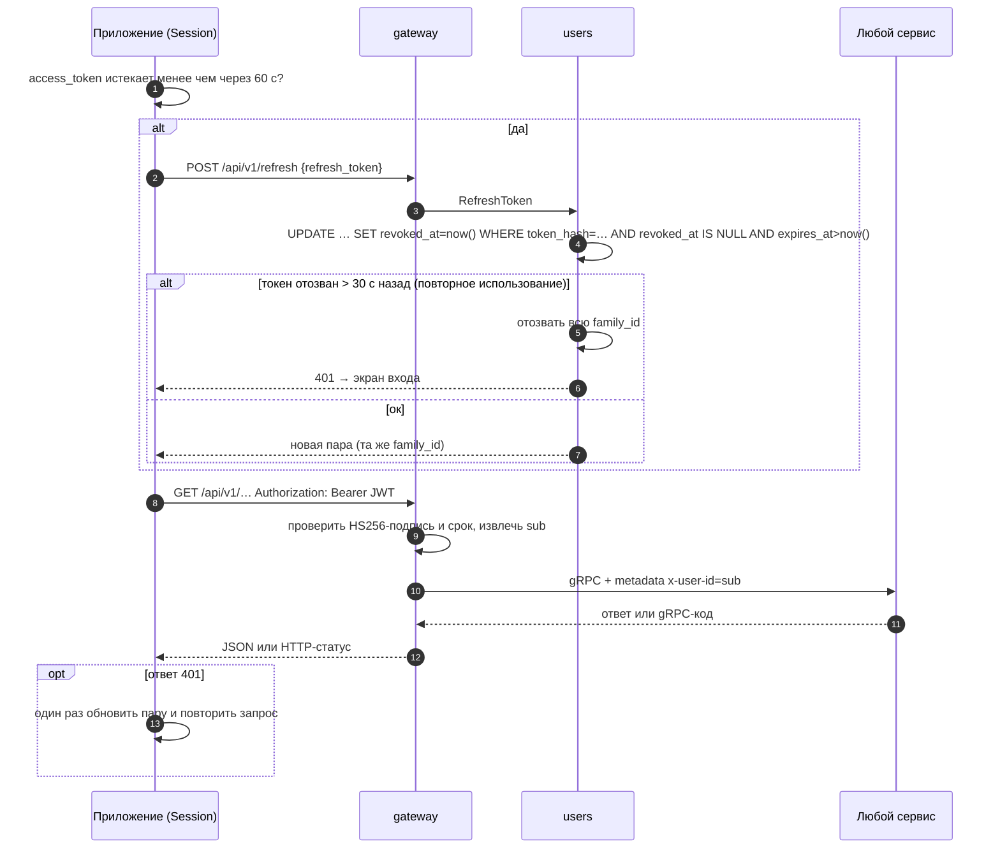
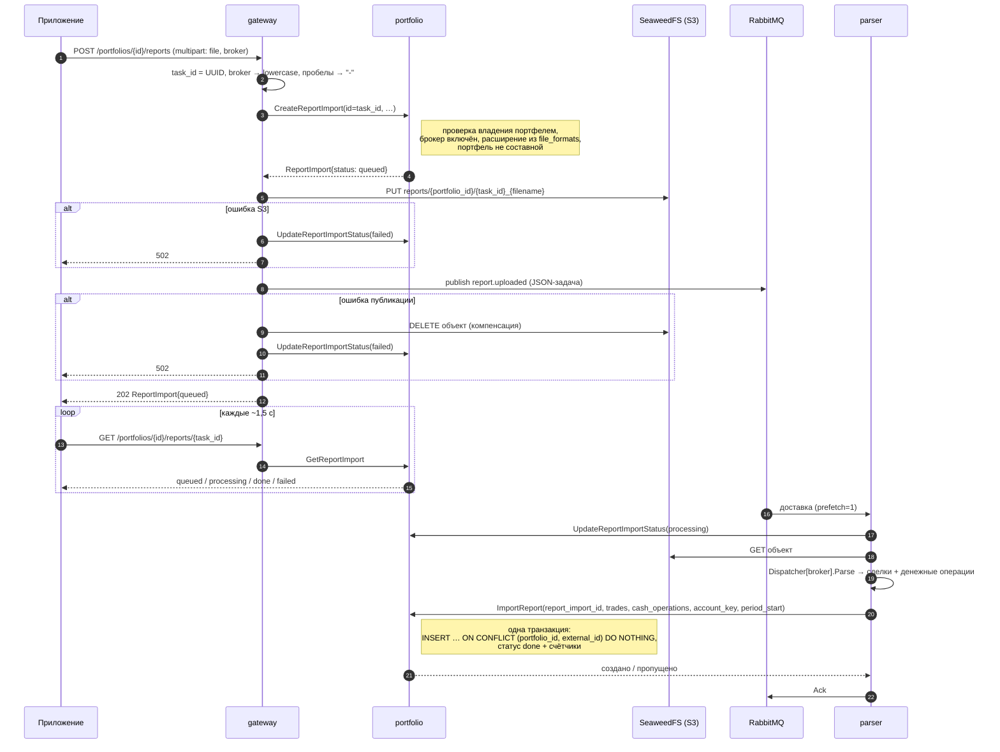
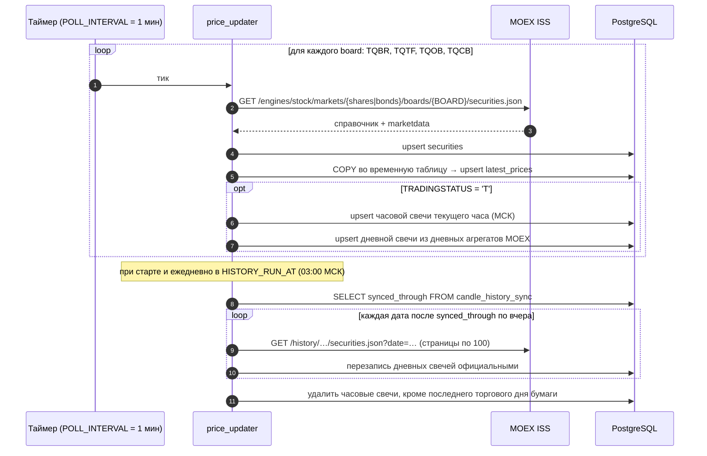
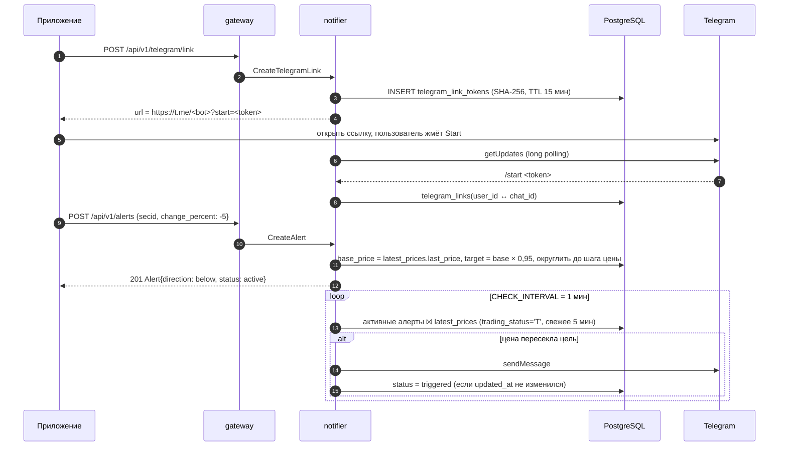

# 3. Сценарии выполнения

## 3.1. Регистрация и вход

- Неизвестный email и неверный пароль дают одинаковую ошибку
  `invalid email or password` с одинаковым временем ответа: защита от
  перебора email (user enumeration).

## 3.2. Авторизованный запрос и обновление токена

## 3.3. Загрузка и разбор отчёта брокера

Обработка ошибок в `parser`:

| Ситуация | Действие с сообщением | Статус импорта |
|---|---|---|
| битый JSON задачи | `Nack(requeue=false)` | не меняется |
| брокер не поддерживается | `Nack(requeue=false)` | `failed` («Отчёты этого брокера пока не поддерживаются») |
| файл не разобрался | `Nack(requeue=false)` | `failed` с текстом для пользователя |
| `portfolio` окончательно отклонил (`InvalidArgument`, `FailedPrecondition`, …) | `Nack(requeue=false)` | `failed`, для неизвестной бумаги — с её `SECID/BOARD` |
| S3 или `portfolio` временно недоступны | `Nack(requeue=true)` | остаётся `processing` |
| пустой отчёт | `Ack` | `done` с нулями |

Dead-letter очереди нет: отклонённые без повтора сообщения теряются (статус
импорта при этом уже `failed`).

## 3.4. Обновление цен (price_updater)

Отдельная задача `price_updater` выбирает из БД последний день с дневной
свечой для каждой бумаги на `MOEX_BOARDS` и загружает из MOEX её
10-минутные свечи (`interval=10`, все страницы). Сохраняет OHLC, объём и оборот
через upsert с заменой, включая текущую незавершённую свечу.

## 3.5. Свечи для графика (securities_reader)

`securities_reader` получает все свечи из PostgreSQL. Запрос графика не
вызывает MOEX. При сбое загрузчика остаются последние сохранённые данные.

| `range` в API | Данные в БД | Свеча |
|---|---|---|
| `day` | 10-минутные свечи последнего доступного торгового дня; если они ещё не загружены для нового дня — часовые свечи из поминутного опроса | `10min` / `hour` |
| `week`, `month`, `year` | дневные свечи за выбранный период | `day` |
| `5y` | недельная агрегация дневных свечей, ограниченная последними 5 годами | `week` |
| `all` | недельная агрегация всей сохранённой дневной истории | `week` |

Глубина доступной истории зависит от `BACKFILL_DAYS` и прогресса загрузки.
По умолчанию это 365 дней: период `5y` не создаёт отсутствующие данные.

### Описание бумаги и дивиденды

`price_updater` запускает независимую задачу при старте и через 15 минут
после завершения прохода. Она выбирает бумаги на `MOEX_BOARDS`, для которых
описание старше 12 часов или дивиденды старше 24 часов (либо ещё не загружены).
Между бумагами — `HISTORY_REQUEST_PAUSE`.

Описание и эмитент загружаются из MOEX и сохраняются вместе; дивиденды —
из dohod.ru отдельным обновлением. Ошибка одного источника не мешает другому
и не затирает сохранённые данные. На облигации запросы дивидендов не делаются.

`securities_reader` читает `security_metadata` при каждом запросе, без
внешних вызовов и кэша. Пока описание не загружено, карточка содержит
название, ISIN и размер лота из `securities`. Пока дивиденды не загружены,
возвращается `Unavailable` (HTTP 502); успешно загруженный пустой список —
обычный ответ. При последующих сбоях источника выдаются прежние данные.

## 3.6. Ценовое уведомление

- Уведомление срабатывает один раз. Повторно оно проверяется только после
  `PUT /api/v1/alerts/{id}`.
- Если Telegram вернул 403 или `chat not found`, привязка удаляется.
  При 429 оставшиеся уведомления переносятся на следующую проверку.
