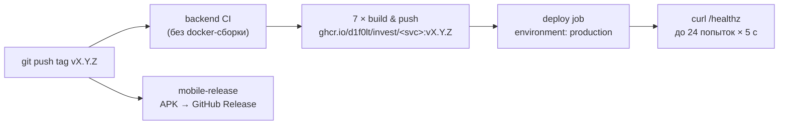

# 9. Развёртывание и CI/CD

## 9.1. Окружения

| Окружение | Где | Как запускается | Адрес API |
|---|---|---|---|
| Локальное | машина разработчика | `docker compose up --build` из `backend/` | `http://localhost:8080` |
| CI | GitHub Actions (`ubuntu-latest`) | workflows `backend`, `mobile` | — |
| Production | один сервер, каталог `/opt/invest` | workflow `deploy` по тегу `v*` | `https://d1f0lt-invest.duckdns.org:8443` |

Staging-окружения нет. Характеристики сервера в репозитории не описаны.

## 9.2. Пайплайны

| Workflow | Триггер | Что делает |
|---|---|---|
| [`backend`](../.github/workflows/backend.yml) | push в `main` и PR с изменениями в `backend/**`; вызывается из `deploy` | по матрице из 7 сервисов: генерация proto, `gofmt`, `go vet`, `go test -race`, `go build`; применение всех миграций к чистому PostgreSQL и интеграционные тесты storage `notifier`; сборка Docker-образов |
| [`mobile`](../.github/workflows/mobile.yml) | push в `main` и PR с изменениями в `mobile/**` | `flutter analyze`, сборка debug APK (артефакт хранится 7 дней) |
| [`deploy`](../.github/workflows/deploy.yml) | тег `v*` или ручной запуск с указанием тега | CI → сборка и push 7 образов в GHCR → выкатка на сервер → проверка `/healthz` |
| [`mobile-release`](../.github/workflows/mobile-release.yml) | тег `v*` | подписанный release APK → GitHub Release |



## 9.3. Выкатка backend

### Новая версия

```bash
git tag v0.1.0
```

```bash
git push origin v0.1.0
```

Что происходит в job `deploy`:

1. Из секрета `ENV_FILE` собирается `.env` и дополняется `IMAGE_TAG`,
   `API_DOMAIN`, `GATEWAY_BIND=127.0.0.1`, `COMPOSE_PROFILES=https`.
   Проверяется, что в нём есть все ключи `.env.example`, и выполняется
   `docker compose config`.
2. На сервер по SSH архивом копируются `.env`, `docker-compose.yml`, `caddy/`,
   `scripts/`, `services/*/migrations` в `/opt/invest`.
3. На сервере выполняется вход в GHCR временным токеном и запускается
   [`scripts/deploy.sh`](../backend/scripts/deploy.sh):
   1. `docker compose pull`;
   2. запуск только `postgres` и ожидание `pg_isready` (до 2 минут);
   3. применение новых миграций (`run-migrations.sh`);
   4. `docker compose up -d --no-build --remove-orphans`;
   5. ожидание статуса `healthy` у `gateway` (до 3 минут, иначе вывод логов и ошибка);
   6. `docker image prune -af`.
4. Выход из GHCR и проверка `https://<домен>:8443/healthz` с повторами.

Параллельные выкатки запрещены (`concurrency: deploy`).

### Откат или повторная выкатка

GitHub → Actions → **deploy** → *Run workflow* → указать уже собранный тег.
Образы не пересобираются, job CI и сборки пропускаются.

> Миграции при откате **не откатываются**. Поэтому каждая миграция должна
> быть совместима с предыдущей версией кода
>.

### Секреты environment `production`

| Секрет | Назначение |
|---|---|
| `DEPLOY_HOST`, `DEPLOY_USER` | куда подключаться по SSH |
| `DEPLOY_SSH_KEY` | приватный ключ (ed25519) |
| `DEPLOY_KNOWN_HOSTS` | отпечаток сервера, защита от MITM |
| `ENV_FILE` | содержимое `.env` по образцу `backend/.env.example` |

## 9.4. HTTPS

- Caddy (`backend/caddy/Caddyfile`, профиль `https`) сам получает сертификат
  Let's Encrypt через HTTP-01 на порту 80 и обслуживает HTTPS на **8443**,
  потому что порт 443 на сервере занят VPN.
- Домен `d1f0lt-invest.duckdns.org` — бесплатный DynDNS DuckDNS.

- Сертификаты хранятся в volume `caddy_data`; продление автоматическое.
- Включены gzip и HTTP/3 (порт `8443/udp`).

## 9.5. Релиз Android-приложения

Тот же тег `v*` запускает `mobile-release`:

1. `flutter pub get`, `flutter analyze`.
2. Ключ подписи восстанавливается из `ANDROID_KEYSTORE_BASE64` и паролей
   в `android/key.properties`.
3. `flutter build apk --release --build-name=X.Y.Z --build-number=<run_number> --dart-define=API_BASE_URL=https://d1f0lt-invest.duckdns.org:8443`.
4. Подпись проверяется через `apksigner`: сборка с ключом `CN=Android Debug`
   считается ошибкой.
5. Создаётся GitHub Release `vX.Y.Z` с файлом `invest-vX.Y.Z.apk` и
   автоматически сгенерированными release notes.

Установка: скачать APK со страницы Releases на телефоне. Новые версии
ставятся поверх старых, потому что ключ подписи одинаковый, а `versionCode`
растёт.

В Google Play и App Store приложение не публикуется.

## 9.6. Первичная настройка сервера

Список восстановлен по workflow; полная процедура подготовки сервера не проверена:

1. Установить Docker Engine с Compose v2.17+ (нужны `additional_contexts`
   и BuildKit).
2. Создать пользователя для выкатки, добавить его в группу `docker`,
   прописать публичный ключ из `DEPLOY_SSH_KEY`.
3. Открыть во внешнем firewall порты 80/tcp и 8443/tcp+udp.
4. Зарегистрировать домен DuckDNS, направить его на IP сервера.
5. Заполнить секреты environment `production` в GitHub.
6. Запустить первую выкатку тегом.
